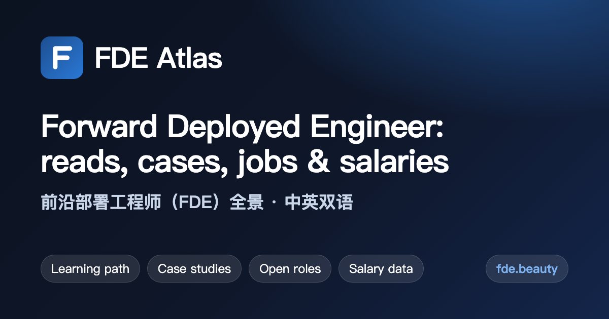

# FDE Atlas

**A bilingual (English / 中文) atlas of the forward deployed engineer (FDE) role**: explainers, a learning path, case studies, open-source resources, open FDE jobs and salary data from public job postings, updated every few hours.

**[Open the site →](https://fde-atlas.github.io/)** · [中文版](https://fde-atlas.github.io/zh/) · [RSS](https://fde-atlas.github.io/feed.xml) · [中文说明](#中文)

## At a glance

As of 2026-11-14:

- **536** [open FDE roles](https://fde-atlas.github.io/jobs/) at **66** [companies](https://fde-atlas.github.io/companies/)
- **$208K** [median disclosed base pay](https://fde-atlas.github.io/salary/) (middle 50%: $162K–$241K, excluding equity and bonus)
- **2,219** [articles](https://fde-atlas.github.io/library/) in the English edition, **2,191** in the [Chinese edition](https://fde-atlas.github.io/zh/library/)
- **345** [open-source repositories](https://fde-atlas.github.io/open-source/) and **21** [Hacker News threads](https://fde-atlas.github.io/community/) about the role

## What's inside

| Section | What you'll find |
|---|---|
| [Featured reading](https://fde-atlas.github.io/featured/) | Trending and essential reads, ranked by Hacker News points, citations and source quality |
| [Learning path](https://fde-atlas.github.io/learn/) | A reading path from understanding the role to landing the job |
| [Case studies](https://fde-atlas.github.io/cases/) | How Palantir, OpenAI, Ramp and others run forward deployed teams |
| [Open-source resources](https://fde-atlas.github.io/open-source/) | Awesome lists, roadmaps, interview prep and tools on GitHub |
| [Analysis and news](https://fde-atlas.github.io/insights/) | Why the model is spreading and the business-model debate |
| [Forward deployed engineer jobs](https://fde-atlas.github.io/jobs/) | Open FDE roles from public job boards, with location and disclosed pay |
| [Forward deployed engineer salary](https://fde-atlas.github.io/salary/) | Disclosed base pay ranges by company, computed from current job postings |
| [Companies hiring forward deployed engineers](https://fde-atlas.github.io/companies/) | Ranked by open roles, with pay ranges and locations |
| [Community discussions](https://fde-atlas.github.io/community/) | Hacker News threads and comments about the role |
| [Library](https://fde-atlas.github.io/library/) | Every article in English and Chinese, with summaries and links to the originals |
| [About](https://fde-atlas.github.io/about/) | Where the content comes from and how to request corrections |

## Topics

- [What Is a Forward Deployed Engineer?](https://fde-atlas.github.io/topics/what-is-a-forward-deployed-engineer/) (146 articles): Definitions, origins and plain-language explainers of the forward deployed engineer role: engineers who embed with customers to ship working software inside their environment.
- [FDE vs Solutions Engineer, SWE and Consultants](https://fde-atlas.github.io/topics/fde-vs-solutions-engineer/) (301 articles): How the forward deployed engineer differs from solutions engineers, sales engineers, solutions architects, product engineers and consultants.
- [Forward Deployed Engineer Salary and Compensation](https://fde-atlas.github.io/topics/forward-deployed-engineer-salary/) (354 articles): What forward deployed engineers earn: base salary ranges, equity, levels and how pay compares with software engineering roles.
- [How to Become a Forward Deployed Engineer: Interviews and Career Path](https://fde-atlas.github.io/topics/how-to-become-a-forward-deployed-engineer/) (643 articles): Interview processes, skills to build, career paths into and out of the role, and first-hand advice from people who have done the job.
- [The Palantir Model: Delta, Echo and the Origins of FDE](https://fde-atlas.github.io/topics/palantir-forward-deployed-model/) (198 articles): Palantir pioneered forward deployed engineering. Its split between Deltas (forward deployed software engineers) and Echos (deployment strategists) still shapes how companies design the role.
- [Why AI Companies Are Betting on Forward Deployed Engineers](https://fde-atlas.github.io/topics/why-ai-companies-hire-fdes/) (117 articles): The business case for forward deployed engineering in the AI era: services versus software margins, moats, deployment companies and the debate over whether the model scales.
- [Building and Managing a Forward Deployed Engineering Team](https://fde-atlas.github.io/topics/building-a-forward-deployed-engineering-team/) (153 articles): Hiring profiles, team structure, managing FDEs, and feeding field learnings back into the product.
- [Forward Deployed Engineers in the Age of AI Agents](https://fde-atlas.github.io/topics/forward-deployed-engineers-ai-agents/) (341 articles): How FDEs deploy LLMs and AI agents in enterprises: evals, RAG, integrations, and getting from demo to production.

## Essential reading

The pieces everyone keeps citing, ranked by citations from other sites, Hacker News points, depth and source quality (age doesn't matter):

1. [Trading Margin for Moat: Why the Forward Deployed Engineer Is the Hottest Job in Startups](https://fde-atlas.github.io/articles/39/): Andreessen Horowitz, 2025-06-04
2. [The Pulse: Forward deployed engineering heats up again](https://fde-atlas.github.io/articles/1018/): The Pragmatic Engineer, 2026-05-24
3. [So You Want to Hire a Forward Deployed Engineer](https://fde-atlas.github.io/articles/3694/): First Round, 2026-02-24
4. [WTF is a forward deployed engineer? (and why everyone is hiring them)](https://fde-atlas.github.io/articles/3614/): PostHog, 2026-02-11
5. [How Palantir built the ultimate founder factory \| Nabeel S. Qureshi (founder, writer, ex-Palantir)](https://fde-atlas.github.io/articles/5407/): Lenny's Newsletter, 2025-05-11
6. [Why 95%+ of Startups Get the Forward Deployed Engineer Role Completely Wrong](https://fde-atlas.github.io/articles/1679/): Powered Future, 2025-12-01
7. [The Palantirization of everything](https://fde-atlas.github.io/articles/40/): Andreessen Horowitz, 2026-01-16
8. [The Rise of the Forward Deployed Engineer — and How To Do the Job Right](https://fde-atlas.github.io/articles/3194/): Latent Space, 2026-09-12
9. [What I learned analyzing 1K forward deployed engineer jobs](https://fde-atlas.github.io/articles/1037/): Bloomberry, 2025-11-18
10. [Forward Deployed Engineers](https://fde-atlas.github.io/articles/3921/): Silicon Valley Product Group, 2025-09-17

More in [Featured reading](https://fde-atlas.github.io/featured/) and the [learning path](https://fde-atlas.github.io/learn/).

## Who's hiring

| Company | Open roles | Base pay (USD) |
|---|---:|---|
| [Databricks](https://fde-atlas.github.io/companies/databricks/) | 119 | $102K–$302K |
| [Palantir](https://fde-atlas.github.io/companies/palantir/) | 90 | $110K–$200K |
| [OpenAI](https://fde-atlas.github.io/companies/openai/) | 36 | $146K–$445K |
| [HappyRobot](https://fde-atlas.github.io/companies/happyrobot/) | 20 | $120K–$220K |
| [Rogo](https://fde-atlas.github.io/companies/rogo/) | 19 | $100K–$200K |
| [Aircall](https://fde-atlas.github.io/companies/aircall/) | 16 | $90K–$299K |
| [Scale AI](https://fde-atlas.github.io/companies/scale-ai/) | 14 | $138K–$345K |
| [Anduril](https://fde-atlas.github.io/companies/anduril/) | 12 | $113K–$254K |
| [Cognition](https://fde-atlas.github.io/companies/cognition/) | 11 | $180K–$280K |
| [Cohere](https://fde-atlas.github.io/companies/cohere/) | 11 | $240K–$415K |

[All 66 companies →](https://fde-atlas.github.io/companies/) · [All 536 open roles →](https://fde-atlas.github.io/jobs/)

## Sources

- **Jobs and salaries** come from the official job boards of companies hiring FDEs (Greenhouse, Lever, Ashby and others). A role counts as open while it still appears on its board.
- **Articles** are published blogs, newsletters, news and reports, with translations for the other language edition.
- **Open-source resources** come from GitHub; **discussions** from Hacker News.
- More in [About](https://fde-atlas.github.io/about/).

## About this repository

This repository holds the published copy of the site served by GitHub Pages. It is replaced on every update, so edits and pull requests here will be lost.

Spotted a mistake, or want an entry corrected or removed? [Open an issue](https://github.com/fde-atlas/fde-atlas.github.io/issues).

Articles belong to their authors; every entry links back to its original source.

## 中文

FDE Atlas 是关于前沿部署工程师（Forward Deployed Engineer，FDE）的中英双语资料站：热门文章、学习路径、真实案例、开源资源、在招岗位和薪资数据，每隔几小时更新。

- 中文版：[https://fde-atlas.github.io/zh/](https://fde-atlas.github.io/zh/)
- 截至 2026-11-14：536 个在招岗位、66 家在招公司、2,191 篇中文版文章
- 专题：[FDE 是什么](https://fde-atlas.github.io/zh/topics/what-is-a-forward-deployed-engineer/) · [FDE 与解决方案工程师、软件工程师、咨询顾问的区别](https://fde-atlas.github.io/zh/topics/fde-vs-solutions-engineer/) · [FDE 薪资与薪酬](https://fde-atlas.github.io/zh/topics/forward-deployed-engineer-salary/) · [如何成为 FDE：面试与职业路径](https://fde-atlas.github.io/zh/topics/how-to-become-a-forward-deployed-engineer/) · [Palantir 模式：Delta、Echo 与 FDE 的起源](https://fde-atlas.github.io/zh/topics/palantir-forward-deployed-model/) · [为什么 AI 公司押注 FDE](https://fde-atlas.github.io/zh/topics/why-ai-companies-hire-fdes/) · [如何组建和管理 FDE 团队](https://fde-atlas.github.io/zh/topics/building-a-forward-deployed-engineering-team/) · [AI Agent 时代的 FDE](https://fde-atlas.github.io/zh/topics/forward-deployed-engineers-ai-agents/)
- 内容有误或希望更正、下架，请[提交 issue](https://github.com/fde-atlas/fde-atlas.github.io/issues)。
